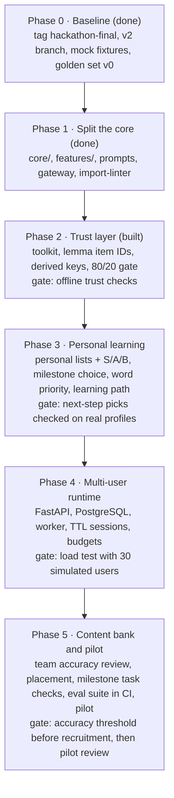

# Japanese Workplace Tutor — Production Architecture

Oct 24, 2026 (updated Oct 25) · Siddhartha (written with Claude). Exported from the Claude Docs original.

## Summary

Recommendation: rebuild teamA as a **deterministic workflow app with the LLM as a bounded component**, not an AI agent. The app owns state, scoring, scheduling and what counts as correct; the LLM only drafts content inside a contract, and every draft passes code checks before a learner sees it.

The core trust rule extends the hackathon's "model proposes, app decides" from scoring to content: **anything that is graded, stored as fact, or shown as authoritative must come from curated data or pass a deterministic check — never from model output alone.**

Status: decisions 1–8 confirmed on 2026-10-24 (see Decisions at the end). **v1 scope:** lessons, due-item review, placement, typed scenarios, translation and the deck localizer for public-only content, and roleplay and practice-presenting as beta. Document upload is on hold until private data can stay on-prem. Phase 0 done on 2026-10-24: local commit \`0507494\` on the \`v2\` branch with an offline mock mode and golden set v0; 135 tests pass. Phase 1 done the same day: commit \`da56d11\` splits the code into core, schemas, prompts, gateway and features, with four import contracts enforced; prompts are unchanged byte for byte, and 268 tests pass. Phase 2 built the same day (commits \`2dffad3\`, \`3924de8\`, 296 tests): the language toolkit, code-verified answer keys, the difficulty report, the public-content checkbox, feedback-only practice and the three review tools. Next step: the Phase 2 gate, the team accuracy review on live model output.

## Where teamA is today

The hackathon build proves the learning loop works, but trust stops at scoring and the runtime is single-user. About 8,300 lines of Python across 8 modules, Streamlit UI, SQLite, 13 test files.

**What is already right — keep it**

- Deterministic mastery and SM-2 scheduling in code (policy `t05-v1`, golden vectors in README).
- Pydantic validation of every model response, one repair attempt, then model fallback.
- Privacy split: only compact evidence persists; lesson, document and translation text stay ephemeral.
- Alembic migrations, idempotent answer submission, secret scanning in tests.

**The trust gap — where the model still decides**

| What learners see or what gets stored | Who decides today | Risk |
| --- | --- | --- |
| Quiz answer keys and distractors | LLM | A wrong key teaches a wrong answer and corrupts mastery |
| JLPT level of an item | LLM estimate (fixture lesson is the only curated data) | Difficulty drifts; progress claims are unverifiable |
| Canonical item identity (`_canonical_item_id` from model text) | LLM wording | Same word tracked as several items; mastery splits |
| Placement (PRD: generated answer keys "trusted for scoring") | LLM | Estimated level built on unchecked keys |
| Roleplay graduation and delivery verdicts | LLM judge | Pass/fail with no reference or calibration |
| Keigo, register and naturalness of translations and deck localization | LLM | Confident but wrong business Japanese |

**What breaks at company scale**

- `generation.py` is 2,506 lines: prompts, transport, fallback, roleplay, decks and coaching in one class. Hard to test or change one feature.
- Streamlit session state holds active lessons; background quiz jobs run in an in-process `ThreadPoolExecutor`. A restart or second worker loses work, and long LLM calls block UI threads.
- SQLite has one writer; fine for a laptop, not for tens to hundreds of concurrent users.
- No evaluation set, so a prompt or model change cannot be shown to be better or worse.
- Prompts live as Python string methods; no versioning, so stored evidence cannot say which prompt produced it.

## Research: which architecture fits and why

The evidence points one way: for a well-defined product like this, use **fixed workflows with programmatic gates**, ground facts in curated data, and treat model output as untrusted input.

| Finding | Source | What it means for us |
| --- | --- | --- |
| Workflows are "predefined code paths"; agents "dynamically direct their own processes." Workflows "offer predictability and consistency for well-defined tasks." Start with the simplest solution; add programmatic checks between steps. | [Anthropic — Building effective agents](https://www.anthropic.com/research/building-effective-agents) | Lessons, quizzes, translation and decks are well-defined. Use prompt chains with code gates, not an autonomous tutor agent. |
| Strict Structured Outputs give 100% schema adherence in OpenAI's evals, but "doesn't prevent all kinds of model mistakes." | [OpenAI — Introducing Structured Outputs](https://openai.com/index/introducing-structured-outputs-in-the-api/) | Schema validity is solved by the provider. Content correctness is not — that is where our checks must go. |
| OWASP LLM05 Improper Output Handling: treat model output as untrusted and validate it. LLM01 Prompt Injection: separate external content, limit privileges, keep humans in the loop. LLM10 Unbounded Consumption. | [OWASP Top 10 for LLMs 2025 (HackerOne summary)](https://www.hackerone.com/ai/owasp-top-10-llms-2025) | Uploaded documents are data, never instructions. The model gets no write access to anything. Per-user budgets. |
| LLM judges can be highly consistent yet wrong: one judge had 0.992 test–retest but κ 0.289 against humans; "85% agreement" can equal κ ≈ 0.48. | [Norman et al., 2026 — Reliability without Validity](https://arxiv.org/pdf/2606.19544) | An LLM judge may flag and advise. It may not pass or fail a learner alone. Calibrate any judge against human labels with κ. |
| ChatGPT-generated vocabulary MCQs had ineffective distractors and ill-matched options; follow-up prompts did not fix them; items "cannot yet be used in operational settings without human moderation." | [AI-generated distractors for a vocabulary test (2024)](https://scitepress.org/PublishedPapers/2024/127624) | Graded items need either a derived answer key or human review. |
| Duolingo: experts design the curriculum, the LLM drafts 10 exercises, experts pick and edit them; "our teaching experts always have the final say." | [Duolingo blog — LLM lessons](https://blog.duolingo.com/large-language-model-duolingo-lessons/) | The proven pattern at scale is draft-then-review, with a curated curriculum above the model. |
| OpenJLPT: 8,334 words and 2,211 kanji tagged N5–N1 (CC BY-SA 4.0); grammar not yet included. | [OpenJLPT on PyPI](https://pypi.org/project/openjlpt/) | JLPT level becomes a lookup, not a model guess. Grammar needs our own curated list. |
| Sudachi (Apache 2.0, Works Applications) gives dictionary form, normalized form, reading and dictionary ID per token. | [Sudachi on GitHub](https://github.com/WorksApplications/Sudachi) | Readings, furigana, canonical item IDs and the 80/20 coverage rule can be computed, not trusted. |
| FSRS needs fewer reviews than SM-2 for the same retention (Anki's stated claim). | [Anki FAQ](https://docs.ankiweb.net/faqs/what-spaced-repetition-algorithm) | Keep SM-2 now, but put the scheduler behind a port so FSRS can replace it. |
| Self-hostable building blocks: Langfuse (MIT core; tracing, prompt versions, datasets, evals), LiteLLM proxy (one OpenAI-compatible endpoint, fallbacks, per-key budgets), Procrastinate (MIT; PostgreSQL as the job queue). | [Langfuse README](https://cdn.jsdelivr.net/gh/langfuse/langfuse@main/README.md) · [LiteLLM self-host guide](https://blog.elest.io/self-host-litellm-one-api-gateway-for-every-llm/) · [Procrastinate](https://github.com/marqov/procrastinate) | On-prem needs no Redis or cloud services: PostgreSQL can carry data, jobs and cost tracking. |

**Conclusion:** the right shape is a modular monolith with a pure domain core (as in learnharness), workflow pipelines per feature, a deterministic Japanese-language toolkit as the source of facts, and a human review lane for anything graded that code cannot verify.

## Trust model: who decides what

*Proposed.* Every output is sorted into one of three trust tiers, and the tier decides who may produce it.

- **Tier 1 — Graded or stored as fact** (answer keys, item identity, JLPT level, mastery, schedules, placement): curated data or code only. The LLM may draft, never decide.
- **Tier 2 — Shown as guidance** (explanations, translations, localized slides, coaching notes): LLM generates, code checks, UI labels it "AI-generated, may contain mistakes", users can flag it.
- **Tier 3 — Practice conversation** (roleplay turns, free chat): LLM live, bounded by input/output limits and a scenario contract. No effect on stored progress.

| Feature | LLM may | Code decides | Human role | Tier |
| --- | --- | --- | --- | --- |
| Quiz answer key | Write the stem and distractor candidates | Key derived from the passage or dictionary (removed token, Sudachi reading, dictionary gloss); distractors rejected if they share reading or synonym group with the key | None for derived keys | 1 |
| Quiz items code cannot verify (nuance, keigo choice) | Draft offline | Checks structure and level | v1: not graded, feedback-only practice until a reviewer exists | 1 |
| Placement test | Nothing at runtime | Items drawn from the derived-key bank only | None in v1 | 1 |
| Item identity and JLPT level | Nothing | Lemma from Sudachi → OpenJLPT / curated grammar list; unknown = "unrated" | Curates grammar list | 1 |
| Mastery and scheduling | Nothing | Evidence ledger → policy → SM-2 (already true today) | None | 1 |
| Lesson passage and explanations | Generate | Target items present in passage; known/stretch ratio measured against learner's items; readings from dictionary | Flag button | 2 |
| Translation, deck localization | Generate both versions | Length and politeness-marker checks; glossary terms preserved | Flag button; sampled review | 2 |
| Roleplay graduation, delivery verdict | Give rubric-based feedback | Records attempts; no pass/fail stored from the judge alone | Learner self-assessment; optional mentor review | 2 |
| Roleplay turns | Converse | Turn and token limits; scenario contract | None | 3 |

The rule of thumb: if a wrong answer would be **remembered** by the system or the learner as correct, it is Tier 1.

## Target architecture

*Proposed.* A modular monolith: one codebase, four layers, with dependencies pointing only toward the core.

*Diagram in the original doc. The current, code-checked version is the system map: open `docs/architecture/architecture.html` (source `docs/architecture/graph.json`).*

Requests flow down. Nothing in the core imports a framework, a database or an LLM SDK, so the same core runs in tests with `MockLLM` and in production with OpenAI.

**How one lesson flows**

1. UI posts a lesson request; the API stores it and enqueues a job, then returns a job id.
2. The worker builds the prompt from the learner profile, weak items and the versioned prompt file, then calls `LLMClient`.
3. Trust gates run: schema, toolkit tokenization, target items present, 80/20 ratio, readings from the dictionary.
4. Failures trigger one repair or a fallback; success writes the lesson to the TTL session table.
5. Quiz keys are derived by code; distractors from the model are filtered.
6. Each answer appends one evidence row; mastery and schedule are recomputed by the progress policy.

## Content and knowledge layer

*Proposed.* A local, versioned "language toolkit" replaces model memory as the source of Japanese facts. It is pure Python plus data files, with no network calls.

| Component | Source | Gives the app |
| --- | --- | --- |
| Tokenizer | SudachiPy + SudachiDict | Dictionary form, reading, normalized form, dictionary ID for every token |
| Vocabulary and kanji levels | OpenJLPT (CC BY-SA 4.0; attribution required) | N5–N1 tag per word and kanji; "unrated" when absent |
| Grammar points | Our curated list (start \~150–250 workplace-relevant patterns) with match rules | Grammar item IDs and levels; detection by token pattern |
| Workplace glossary | Curated per role/domain (IOWN, DPU, sales, HR…) | Terms that must be preserved in translation and decks |
| Item bank | Reviewed questions, placement items, fixture lessons | Tier 1 graded content |

**What this unlocks**

1. **Stable item identity.** `item_id = category + lemma dictionary ID`, so 「確認します」 and 「確認した」 both update 確認. Today, wording differences split mastery.
2. **Measured difficulty.** After generation, code tokenizes the passage and computes the share of known, at-level and stretch items against the learner's mastery. The PRD's 80/20 rule becomes a gate with a number, plus a regenerate-or-accept threshold.
3. **Derived furigana.** Readings come from the dictionary, so furigana is never hallucinated. Ambiguous readings are left unannotated rather than guessed.
4. **Derived answer keys** for reading, meaning and cloze questions (see Trust model).

**Caching.** Generated Tier 2 content for non-personal inputs (surprise topics, fixture scenarios) is cached by `hash(prompt version, model, inputs)`. Repeat lessons cost nothing, and reviewers can promote good cached lessons into the bank. Personal scenario and document content is never cached, matching the PRD retention table.

**Licensing note.** CC BY-SA 4.0 requires attribution and share-alike for the dataset if we redistribute it. For internal use, keep it as a separate data file with its NOTICE and do not mix it into proprietary datasets. Confirm with legal before external distribution.

## LLM gateway

*Proposed.* All model access goes through one port, `LLMClient`, with swappable adapters. Feature code never imports an SDK.

```python
class LLMClient(Protocol):
    def generate(self, task: PromptTask[T], *, user_id: str) -> Generation[T]: ...
# Generation[T] = parsed object + model id + prompt version + tokens + latency + cost
```

| Adapter | Use | Notes |
| --- | --- | --- |
| `MockLLM` | Tests, CI, local dev without keys | Returns recorded fixtures keyed by task + inputs; can inject timeouts, refusals and wrong keys to test the gates |
| `OpenAILLM` | Production (keys added later) | Strict Structured Outputs from the Pydantic model; timeouts; retries on 429/5xx only |
| `TsuzumiLLM` | Optional later | Same port; nothing else changes |

**Prompts as versioned files.** Each feature has `prompts/<feature>/<name>.v3.md` with a front-matter schema reference. The prompt version is stored with every evidence row, so we can tell which prompt produced which learning outcome.

**Pipeline per call:** build prompt → call adapter → schema parse → domain validators (toolkit checks) → accept, or one repair with the validator's error list → fallback model → safe failure. This keeps today's fallback policy but moves it out of feature code.

**Data class on every task.** Each `PromptTask` carries `PUBLIC` or `PRIVATE`. v1 sends only `PUBLIC` tasks, and user-supplied text or decks require a "this is public / non-confidential" checkbox plus a visible note not to upload work data. `PRIVATE` tasks are refused until an on-prem adapter exists (tsuzumi 2 or an open model on vLLM), and a test proves they can never reach the external adapter.

**Cost and abuse limits (OWASP LLM10).** Per-user daily token budget, per-request input caps (document size already capped at 50 KB), and a global monthly ceiling with an alert. Usage is stored per user and feature.

**Logging and privacy.** By default log metadata only: task, prompt version, model, tokens, latency, validator outcome, fallback reason. Prompt and response bodies are logged only for non-personal tasks or with an explicit debug flag, because the PRD keeps documents and translations ephemeral.

**Optional: LiteLLM proxy.** A self-hosted proxy adds central keys, fallbacks and budgets. It is worth it once several apps share the keys; for one app the in-process port is simpler.

## Quality and evaluation

*Proposed.* Three loops keep quality measurable: an offline eval suite that gates changes, a review queue for Tier 1 content, and learner flags in production.

**1. Eval suite (gates every prompt or model change)**

- A golden set of \~50–100 inputs per feature: profiles × scenarios × levels, plus adversarial cases (prompt injection in documents, English-only text in Explain mode, very long decks).
- Deterministic metrics first: schema pass rate, validator pass rate, derived-key agreement, known/stretch ratio, latency, cost per lesson.
- Rubric metrics second (naturalness, keigo fit): LLM judge with randomized option order, at temperature 0, reported as κ against a human-labelled subset of at least 50 items.
- Runs in CI against `MockLLM` recordings (free, deterministic) and nightly or on demand against the real model. Tooling: plain pytest first; promptfoo or Langfuse datasets if the suite grows.

**2. Content review queue (backlog until a reviewer is available)**

1. A batch job drafts candidate items for a topic and level.
2. Toolkit validators reject structural and level failures automatically.
3. An LLM judge scores the rest and sorts the queue; it never approves.
4. A reviewer (native or N1-level colleague) approves, edits or rejects in an admin page.
5. Approved items are versioned in the bank; edits keep the history.

**3. Production feedback**

- "Flag this" on every Tier 2 output, with a reason (wrong Japanese, unnatural, wrong level, other).
- Weekly sample of flagged and random outputs to the review queue.
- Item-level analytics from the evidence ledger: items most learners miss on first try are checked for a bad key or bad distractors.

**Release rule:** a prompt or model change ships only if deterministic metrics do not regress and the rubric score is not significantly worse on the golden set.

## Deployment on-prem

*Proposed.* One Linux server, Docker Compose, five containers. That is enough for tens to hundreds of NTT-AT users because the heavy work (LLM calls) happens at OpenAI, not on our hardware.

| Container | Role | Scales by |
| --- | --- | --- |
| `proxy` (Caddy or nginx) | TLS, internal hostname, static files | — |
| `web` | UI. Phase 1: Streamlit as a thin client of the API. Later: a proper web frontend if needed | Replicas behind the proxy (sticky sessions for Streamlit) |
| `api` (FastAPI) | Auth boundary, workflows, domain core, toolkit | Replicas; stateless |
| `worker` | LLM jobs (lesson, quiz, deck, batch drafting) from a PostgreSQL queue | Replicas; concurrency per worker |
| `db` (PostgreSQL) | Users, profiles, evidence ledger, item bank, jobs, usage, active-session drafts with expiry | Vertical; daily backup |

**Why jobs move out of the UI process.** Today a lesson's quiz runs in a `ThreadPoolExecutor` inside Streamlit. With a queue, a lesson request returns at once, the worker does the slow call, and the UI polls or streams status. A restart loses nothing, and two workers can serve many users.

**Ephemeral content at scale.** Active lessons and document text move from Streamlit memory to an `active_session` table with a TTL (for example 2 hours) and a cleanup job. Optionally encrypt that column. This keeps the PRD's "not retained after the session" promise while surviving a restart.

**Network and data.** The server needs outbound HTTPS to the OpenAI API only. Private documents may not leave the company network (decision 2), so v1 accepts only content the user marks as public. The deck localizer stays available behind a clear note not to upload work data and a required public-content checkbox; document upload waits for an on-prem model.

**Operations.** Health endpoint (DB, queue depth, model reachability), structured JSON logs, a usage dashboard (calls, cost, failures by feature), Alembic migrations on deploy, nightly `pg_dump`. Auth stays local accounts for now, behind an `IdentityProvider` port so SSO can be added later without touching the domain.

## What we borrow from learn and learnharness

Both projects are single-user tools, so we take their structure and discipline, not their runtime.

| Idea | From | Take it? | How it lands here |
| --- | --- | --- | --- |
| Pure domain core with ports and adapters; imports point inward | learnharness `docs/architecture.md` §1–3 | Yes | `core/` has no IO; `adapters/` implement its ports |
| Import law enforced by a linter | learnharness ESLint zones | Yes | `import-linter` contracts in CI for Python |
| One composition root wires everything | learnharness `stores.ts`, `chat-handler.ts` | Yes | `app/bootstrap.py` is the only place adapters are chosen (Mock vs OpenAI, SQLite vs PostgreSQL) |
| Append-only evidence; everything else derived | learnharness "the unifying law" | Yes, strengthen it | `ReviewAttempt` is already immutable. Make mastery and schedule recomputable from it, so a policy change (SM-2 → FSRS) can be replayed |
| One writer per store | learnharness six systems | Yes | Only the progress service writes evidence; only the bank service writes the item bank |
| Deterministic tests with no LLM and no network | learnharness `npm test` | Yes | All tests run on `MockLLM` |
| Visible, editable prompts | learnharness README | Yes | Versioned prompt files |
| Teaching principles: unconditional truths first, "how could I have discovered this?" | learn `skills/teach/SKILL.md` | Partly | Prompt fragment for explanations (why this keigo form exists), not a runtime agent |
| Researcher subagent to verify truth | learn `agents/researcher.md` | No | We verify with the deterministic toolkit and human review instead |
| Free-running teacher agent, wake pipeline, sub-agents | learnharness Classroom and Workbench | No | Unbounded behaviour and cost for many users; workflows are enough |
| File-based JSON stores, bring-your-own keys | learnharness Machine room | No | Multi-user needs PostgreSQL and company-managed keys |
| Knowledge graph of propositions | learnharness Library | Later, maybe | A prerequisite graph for grammar points could guide lesson order in a later phase |

**More to adopt, found on a full read** (learnharness `docs/architecture.md` §7, §9, §11; `teaching-methodology.md`; `src/core/question-core.ts`; learn `skills/teach/SKILL.md`)

| Idea | From | How it lands here |
| --- | --- | --- |
| "I don't know" is its own answer, never a guess; stated confidence rides on real answers | `question-core.ts` (CONFIDENCE\_STOPS, dontKnow) | Add "I don't know" next to teamA's existing sure/guessed. It records a gap without a lucky-guess risk, and guessed answers weigh less in mastery |
| Build distractors by mutating the correct claim; no reasoning in any option; no option descriptions (they leaked answers) | learn `teach/SKILL.md` quiz procedure; learnharness owner ruling 2026-09-26 | Goes in the quiz prompt, plus a code check: flag sets where the key is much longer or more specific than the distractors |
| Probing finds the edge by bracketing: a floor (right) and a ceiling (wrong) per strand, jumping difficulty sharply | learn `teach/SKILL.md` Phase 1a; `teaching-methodology.md` §1 | Placement becomes a deterministic staircase over the derived-key bank, per strand (vocabulary, kanji, grammar, reading). It stops when every strand is bracketed |
| Commit before pose: solution and rubric exist before the learner answers | learnharness §7 | Roleplay and translation feedback: the rubric is generated first, then the learner's answer is scored against it (less sycophancy) |
| Practice is strengthening, not assessment; its scores write nothing to progress | learnharness §7 owner ruling 2026-09-29 | Matches decision 6: roleplay is beta, feedback only |
| Difficulty as named, discrete levels, never a free number | learnharness §7 ladder and cue distance | Lesson requests use named levels (e.g. worked example, guided, independent) that prompts and UI share from one table |
| "LLMs judge; code mechanizes"; a failed LLM stage saves nothing; "absence is not zero" | learnharness §9 Tier C | Already our trust rule. Also: unknown JLPT level shows as "unrated", never a guessed level |
| One shared concurrency cap for background LLM jobs; a boot sweep marks orphaned jobs as interrupted | learnharness §7 semaphore, boot sweep | Worker concurrency limit and a stale-heartbeat sweep in the job queue |
| Four test strata with a fake provider: core units, server flows, pipelines, render | learnharness §11 | Same strata in pytest over `MockLLM` |
| A decision-history table: superseded choices are not reopened without new evidence | learnharness §13 | The Decisions table below keeps this role |

## Migration plan

*Proposed.* Refactor teamA in place in five phases. Each phase ends at a gate (the diamond), and the app keeps working after every phase.



**2026-10-28 phase-order update:** Code verification remains in Phase 2. By user direction, the hands-on team accuracy review moves to Phase 5 before pilot recruitment, using the three methods in decision 9 and a threshold set before scoring. Phase 3 can proceed with offline tests and mock mode. No dates yet; they depend on team size and the pilot date (Open question 7).

**Provider update:** The `v3` implementation accepts Azure OpenAI v1 and versioned deployment chat-completion routes. Its endpoint, deployment names, and API key remain local configuration values; live verification waits for those values.

**Revised 2026-10-25 (decision 16).** Phase 3 is now personal learning: personal lists, word priority, the learning path and milestone choice. The multi-user runtime moves to Phase 4, and the content bank, milestone task checks and pilot become Phase 5. The pilot date (decision 7, around January 2027) needs re-checking against the longer path.

### Phase 3 addition: personal word and grammar lists

Each learner keeps a personal list on top of the shared reference lists (decision 12). The shared lists change only through the reviewer queue, so the team accuracy review always measures one fixed version.

| What the learner does | What happens, for that learner only |
| --- | --- |
| Add a word, one at a time or many by pasting lines | Counts as in section for difficulty (like a Business Japanese word) and is favoured as a lesson target. Reading comes from the dictionary, never the model |
| Grade an entry S, A or B (S = needed for my job now, A = important, the default, B = nice to have). Works on their own entries and on shared words | Sets how often the word or grammar point is picked as a lesson target (S 3×, A 2×, B 1×) and puts S items first when more than five reviews are due. It does not change mastery, answer keys or review intervals |
| Add a grammar point | Matched to the curated grammar list: graded normally. No match: practice only (no code-verified key) and sent to the reviewer queue |
| Hide a shared word | No longer favoured as a target. Still counts as in section, so hiding can never make a passage fail |
| Add or reject words that others in the same role also do | Automatic, no reviewer (decision 14): a word 3 or more learners in the same role add joins that role's pack; a pack word 3 or more mark "not useful" is demoted |
| Export the list | Copy their list as plain text, one entry per line |

**Adding many at once**

- Two text boxes, Words and Grammar, one entry per line. A meaning may follow a comma (`進捗, progress` or `進捗、progress`); readings always come from the dictionary.
- Limits: 500 lines per paste, 2,000 entries per learner, 100 characters per line.
- Preview before saving, one status per line: added; already on a shared list (kept as a personal priority); not in the dictionary (kept, ungraded until reviewed); duplicate; rejected (too long, or no Japanese). Blank lines are skipped.
- Only the parsed entries are stored, never the pasted text as a whole.
- Grade: a dropdown sets S, A or B for the whole paste; a line starting with ` S  `, ` A  ` or ` B  ` overrides it (`S 進捗, progress`). Grades can be changed later in the list view.

**Privacy.** List entries are sent to the model as lesson targets, so both add boxes carry the same public-only checkbox and note as the deck localizer: no project names, client names or internal terms (decision 2).

**Build.** One table, `personal_terms` (user, kind, expression, lemma, reading, meaning, grade S/A/B, status active or hidden, source single or pasted, created at). The difficulty check and the lesson generator each read it through a port. A small settings page. Roughly one day plus tests; see the Phase 3 implementation plan for sequencing.

### End goal: milestones the learner chooses

Each learner works toward a milestone they pick; a milestone is done when its checklist passes, then the tool switches to maintenance (due reviews only) or the next milestone (decision 13).

| Milestone | Read | Write | Speak / present | Roughly |
| --- | --- | --- | --- | --- |
| 1. Get by | Schedule and attendance emails, notices | Short replies | Greetings, self-introduction, asking for help | CEFR A2 |
| 2. Take part | Agendas, minutes, routine emails | Status email or meeting summary | 2–3 minute progress update from notes | CEFR B1 |
| 3. Contribute | Specs, reports, client emails | Short report, request with reasons | Explaining your work, a 5-minute talk | CEFR B2 |

| Check | Who decides | Pass rule |
| --- | --- | --- |
| Words and grammar | Code | 80% or more of the milestone's sets mastered (union of sets, each word once) |
| Reading | Code | Code-verified questions on a passage at that level, passed twice on different days |
| Writing | Code + AI feedback | Code checks required words and grammar; AI comments on naturalness only |
| Presentation | A person | AI rubric feedback as evidence; learner confirms, optional senior sign-off |

**Build steps**

1. Before the team accuracy review — **built** (`3c3e217`): items keep their reference-list name (migration 0009, never learner text); status new / learning / mastered / slipping; coverage per JLPT, grammar and Business set; `milestones_v1.json` with word progress per milestone; learner-facing Progress page. Items from generated lessons now come back for due reviews with code-built meaning or reading questions (keys DERIVED, graded); before this only the sample lesson's items were reviewable.
2. Phase 3: milestone choice in the profile; S-graded personal words join the target set.
3. Phase 5: reading, writing and presentation checks; maintenance mode; pilot metrics (recall at due reviews, 30-day retention, coverage growth per month, placement before and after, can-do self-ratings).

**Dependency.** The placement test (v1 scope, not built) must be ready before the pilot starts, so each learner has a starting score.

### Seeing progress over time

**Built** (`1364c42`, decision 15). Learners see how far they have moved, not only where they are. Answers are stored once and never changed, so the app replays them through the same policy to rebuild mastery at any past moment; nothing extra is stored.

| Where | What the learner sees | How it is worked out |
| --- | --- | --- |
| Home: This week | Newly mastered, recalled after a gap, answers, slipping | This week's answers; weeks start Monday 00:00 Japan time |
| Progress: Over time | Items mastered at the end of each week (line) | Replay of every graded answer up to that week's end |
| Progress: Over time | Recall per week (bars), with a table view | Answers 12 hours or more after the item's previous answer, retries excluded |
| Progress: Milestones | Change in each milestone's share over the last 4 weeks | Coverage now vs. 4 weeks ago, from the replay |

Later: "at your pace" estimate and level messages (25%, 50%, 80%); domain-word progress (Phase 3); monthly can-do self-check (Phase 5). No streaks or points: they measure activity, not learning.

### Personal priority: the words each learner needs

Code, not the AI, picks each lesson's target words from a shared word bank, ranked by how much this learner needs them; the AI then writes the conversation around those words and code checks they appear (decision 14). Phase 3, built together with personal lists.

```latex
\text{priority}(w,u) = \big(0.4\,D + 0.3\,S + 0.2\,C + 0.1\,F\big) \times g \times (1-m) \times L, \qquad D = \max_{d \in \text{domains}(u)} \text{match}(w,d)
```

D = domain match (best over the learner's chosen domains), S = situation, C = who they talk to, F = how common the word is, g = their S/A/B grade (3, 2, 1), m = mastery, L = 1 if the word is at most one level above them. Weights are starting guesses, tuned with pilot data. The score is computed when a lesson is picked, never stored per user.

| Layer | Packs | Example words |
| --- | --- | --- |
| Everyone | General office (the Business Japanese list) | 会議, 確認, 共有 |
| All engineers | Engineering common | 仕様, 設計, 検証, 不具合 |
| Engineering, choose any | Hardware / electronics; Software; AI / ML; Network; Electronics lab; Quantum | 回路, 実装, 推論, 帯域, 校正, 量子ビット |
| Business, choose any | Sales; Marketing; Management | 見積もり, 施策, 予算 |
| Other professions | Free-text role, matched to the nearest packs by similarity | General office if nothing matches |

**Where pack words come from.** Readings, meanings and levels always come from dictionaries (JMdict, Sudachi), so the only open question is relevance. Sources: JMdict field tags (computing, engineering, electronics, business); packs drafted by the AI; a local embedding model on the on-prem server (profiles never leave it) for ranking and for roles without a pack; each learner's personal list and grades.

**Review without reviewers.** There is no team to review the Japanese regularly, so:

1. Code drops any AI-proposed word that is not in the dictionary. A word is "confirmed" when a second source agrees (a JMdict field tag or high similarity); unconfirmed words get half weight.
2. One review at the start: Siddhartha keeps or drops each engineering pack word once (about 30 minutes per 150 words); someone in sales does the same once for the business packs.
3. After that, learner signals keep packs current: 3 or more learners in a role adding a word adds it; 3 or more marking it "not useful" demotes it.
4. Optional spot check: 20 random pack words on the Accuracy page in reviewer mode. Never required.

**Microsoft 365 Copilot as a manual source.** Siddhartha has Microsoft 365 Copilot, which can read his work email, Teams chats and files. A learner asks Copilot for a list of the Japanese words they use most, one per line, with no sentences and no names of people, clients or projects, then pastes it into their personal list. The app keeps only dictionary words, takes readings and meanings from the dictionary and shows a preview before saving. Work content stays inside Microsoft 365; only single dictionary words reach this app and OpenAI. Copilot's "most used" is an estimate, not a count. Check with IT that exporting word lists is allowed. A direct connection through the Microsoft 365 Copilot APIs (Copilot licence per user, Entra ID app registration, IT approval; the Chat API is in preview) is not planned for the pilot.

### Phase 3 addition: learning path

Learn becomes a path instead of one-off lessons: situations come from a map per milestone, language tracks run alongside them, and code plans each day (decision 16).

**Situation map.** Each milestone has a fixed list of situations from its can-do tasks. Each one varies along four axes, so there is always a new version, and the app tracks which ones a learner has done (for example "Take part situations: 14 of 40 tried").

| Axis | Examples |
| --- | --- |
| Situation | Status update, asking for help, joining a meeting, scheduling, reporting a problem |
| Who you talk to | Manager, peer, another team, client |
| Channel | Face to face, email, Teams chat, phone |
| Complication | None, a delay, a disagreement, apologising for a mistake |

**Language tracks.**

| Track | One lesson | Graded by |
| --- | --- | --- |
| Grammar path | One point in level order, with work examples and fill-in-the-blank questions | Code, from the grammar list |
| Word sets | 5–8 words from the learner's domain packs and S-graded words | Code, from the dictionary |
| Kanji readings | Readings of the kanji in the learner's words | Code, from the dictionary |
| Keigo | Verb forms (行く → いらっしゃる / 参る) from a curated table; nuance practice | Code for forms, AI feedback for nuance |
| Reading | A longer email or minutes at the learner's level | Code-verified questions |
| Writing and speaking | Write the email, give the update | AI feedback only (decision 6) |

**Today plan on Home.**

1. Due reviews first (up to 5).
2. Next step, chosen by code: the track furthest behind for the learner's milestone, with the reason shown ("Next: grammar 〜ておく. Your N4 grammar is at 20% but your words are at 45%").
3. Optional free practice: typed scenario, own text, roleplay, presentation.

Situation lessons and language lessons alternate, so separately practised words and grammar reappear inside conversations. The same planner serves word priority (decision 14). Order inside Phase 3: personal lists and word priority, then the situation map and grammar path with the Today plan; reading, keigo and writing tracks after.

## Decisions

All sixteen were settled in grill-me sessions on 2026-10-24. One item stays open: the vibe-wise skill file, which was not found in the workspace.

| # | Decision | Outcome |
| --- | --- | --- |
| 1 | First-release scope | Lessons, due-item review, placement, typed scenarios, translation, deck localizer; roleplay and practice-presenting as beta (feedback only). Document upload on hold (see 2) |
| 2 | Private documents and OpenAI | Private-data routing on hold. v1 accepts only user content marked public, with a visible note not to upload work data. Every prompt task carries a `PUBLIC`/`PRIVATE` tag. Later options: on-prem model (tsuzumi 2 or vLLM), send extracted items instead of documents, or contract terms (zero data retention) if security agrees |
| 3 | Human reviewers | None yet. Only code-verified (derived-key) questions are graded; keigo and nuance are feedback-only practice. Review page moves to the backlog |
| 4 | UI | Keep Streamlit as a thin client of a FastAPI backend |
| 5 | Scheduler | SM-2 (`t05-v1`) behind an interface, replayable from the evidence log; consider FSRS after pilot data exists |
| 6 | Roleplay and delivery judges | Beta: rubric feedback only, no stored pass/fail; graduation is the learner's self-check |
| 7 | Pilot | 20–30 users from 2–3 teams, about 3 months, target start around January 2027 |
| 8 | Repository | Tag `main` as `hackathon-final`; refactor on a `v2` branch in SiddharthaKR/teamA |
| 9 | Phase order | Trust layer (Phase 2) before multi-user (now Phase 4, decision 16). Siddhartha and the team check accuracy themselves before any wider rollout, three ways: a \~100-row review sheet from the golden set with an error-rate target they set, an in-app reviewer mode with "mark wrong" on every item, and a couple of weeks of normal team use with informal reports |
| 10 | Phase 1 forks | Delete the dead one-shot generate() path and port its tests; prompts as Python modules with PROMPT\_VERSION and byte-for-byte snapshot tests |
| 11 | Reference word lists | tanos JLPT lists are primary, OpenJLPT only fills gaps, plus a curated Business Japanese list. A word on several levels counts at its easiest. A lesson passes when most of its words are at the learner's level or Business Japanese |
| 12 | Personal lists | Phase 3: each learner can add words and grammar (one at a time or many lines at once), grade any word or grammar point S, A or B by importance, hide shared words, and mark words not useful; words that 3 or more learners in a role add or reject change that role's pack automatically. The shared lists stay fixed for the accuracy review |
| 13 | End goal | Learner-chosen milestones (Get by, Take part, Contribute), each done when its word coverage reaches 80% and its reading, writing and presentation checks pass; presentations confirmed by a person. Then maintenance or the next milestone |
| 14 | Personal word priority | Phase 3: code ranks words by a need score (domain, situation, who they talk to, frequency, grade, mastery, level) and picks lesson targets. Broad packs, several domains per learner. Hybrid sources, one start-up review, then learner signals instead of a reviewer queue. Microsoft 365 Copilot used only as a manual paste-in source |
| 15 | Showing progress | Built before the team review: a This week card on Home, items mastered and recall charts by week, and each milestone's 4-week change, all replayed from stored answers. Forecast, domain words and can-do checks follow in Phases 3 and 4; no streaks or points |
| 16 | Learning path and phase order | Phase 3 = personal learning: personal lists, word priority, a learning path (situation map, language tracks, Today plan chosen by code) and milestone choice. Multi-user runtime moves to Phase 4; content bank, milestone task checks and pilot become Phase 5 |
