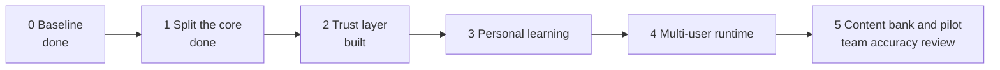

# Phase plan — for team review

Status 2026-10-27. This is the plan for turning the hackathon app (3rd prize) into an internal NTT-AT tool. Please review the phases, the exit gates and the open questions below before Phase 3 starts. Details: `docs/design/architecture-v2.md` (design, decisions 1–16), `docs/handoff/TASKS.md` (task list), `docs/ux-review/README.md` (UX walkthrough), and `docs/superpowers/plans/2026-10-27-phase-3-personal-learning.md` (Phase 3 sequence, checks and exit evidence).

## How to review

1. Read this page (about 10 minutes); open the linked docs only where you disagree.
2. Comment on the pull request from `v2` to `main` (line comments on this file are easiest), or reply to Siddhartha directly.
3. Add your name to the review table at the bottom with "approve" or "changes".

## The idea in one line

The AI writes lessons; code checks them and decides what is graded and how a learner progresses. Trust before scale: accuracy is checked by the team before more people use it.

## Phases

| Phase | Goal | Main contents | Exit gate | Status |
| --- | --- | --- | --- | --- |
| 0 Baseline | A safe starting point | Hackathon tagged `hackathon-final`; offline mock mode; 56-case golden test set | Tests pass offline | Done |
| 1 Split the core | Code we can test and trust | Core rules separated from UI and AI; one AI gateway; versioned prompts | No feature imports an AI SDK | Done |
| 2 Trust layer | Nothing graded comes unchecked from the AI | Dictionary-based readings and JLPT levels (tanos lists + 160-word Business Japanese list); code-checked answer keys; difficulty check; privacy checkbox; reviewer mode; progress page with milestones and progress over time | Offline trust and architecture tests pass | Built; UX fixes A1–A11 remain implementation work |
| 3 Personal learning | Lessons fit each person's job and goal | Personal word lists (paste lines, importance star); word priority by role and domain packs (hardware, software, AI, network, lab, quantum, sales, marketing, management…); learning path (situation map, grammar/word/kanji/keigo/reading tracks, a daily "Today" plan); milestone choice; typed answers and sentence reviews | Three real role profiles complete the Today-to-lesson loop with sensible, explained next steps and verified targets; offline suite and migrations pass; reviewer verdict recorded | In progress on `v3`: milestone choice and personal term intake; [execution plan](../superpowers/plans/2026-10-27-phase-3-personal-learning.md) |
| 4 Multi-user runtime | Run for many people on the on-prem server | FastAPI + PostgreSQL + job worker; per-user budgets; real login; daily reminder | Load test with 30 simulated users | Planned |
| 5 Content bank and pilot | Prove it works | Team accuracy review before pilot recruitment; placement test; milestone checks (reading, writing, presentation); listening via text-to-speech; eval suite in CI; pilot with 20–30 people from 2–3 teams | Team-set accuracy threshold passed before pilot; pilot review: error flag rate, cost per lesson, retention | Planned |

Milestones (the learner's finish line): **1 Get by** (about CEFR A2), **2 Take part** (about B1: follow meetings, give a 2–3 minute update), **3 Contribute** (about B2: explain your work, write a short report). Each is done when 80% of its words and grammar are mastered and its reading, writing and presentation checks pass.

## Questions for reviewers

| # | Question | Current proposal |
| --- | --- | --- |
| 1 | What error rate is acceptable for the Phase 5 pre-pilot accuracy gate? | Team to set before scoring (for example, under 5% wrong items in the review sheet) |
| 2 | Is "personal learning" (Phase 3) before "multi-user" (Phase 4) the right order? | Yes: personalisation decides the data model the server will need |
| 3 | Is a pilot around January 2027 still realistic with this order? | To re-check after Phase 3 is sized |
| 4 | Do the three milestones and their word sets match what your teams need at work? | `src/japanese_workplace_tutor/resources/milestones_v1.json` |
| 5 | Which domain packs first, and who reviews the business packs once? | Engineering packs reviewed by Siddhartha; one person from sales for business packs |
| 6 | Typed answers (kana readings, words) as well as multiple choice: acceptable effort for learners? | Yes, they help memory most and code can grade them |
| 7 | Speaking and pronunciation stay out of scope (typed practice and listening only)? | Yes for now |
| 8 | Privacy: only public content goes to OpenAI; Copilot word lists pasted by hand. Who checks this with IT? | Owner to be named |
| 9 | Presentation checks: learner self-check plus optional senior sign-off. Who would sign off? | Optional; a link the senior opens without an account |

## Review table

| Reviewer | Phases reviewed | Approve / changes | Comments |
| --- | --- | --- | --- |
| | | | |
| | | | |
| | | | |
