# UX review: Japanese Workplace Tutor

Oct 25, 2026 · Siddhartha (written with Claude). Exported from the Claude Docs original.

A walkthrough of the app as a new learner, plus a review of the planned Phase 3–5 flow.

## Top findings

The learning loop works end to end, but two problems weaken what progress means, and a lot of developer wording is still in front of learners. Ranked by how much they hurt learning:

1. **The quiz shows the answers.** Fill-in-the-blank questions print the full source sentence ("From the lesson: …変えてもいいですか"), and the glossary with every meaning sits directly above the questions. A correct answer can come from reading, not memory, and it still raises mastery.
2. **"Mastered" can come from one sitting.** The mastery rule counts separate lesson *sessions*, not separate *days*. Three lessons within about 15 minutes counted as three sessions, so the first review scored "Easy" and pushed the next review a month away. The Progress page caption ("recalled correctly on separate days") is not true today.
3. **Developer wording is visible to learners**: "Demo authentication … laptop demo", the "Startup health / SQLite foreign keys" panel, "Start fixture lesson", "records exposure only", "Outcome: Easy", "Source: override-v1", "Contextual Cloze", and Streamlit's own "Deploy" menu.
4. **The first run gives no direction.** The profile starts as "Software engineer" with tasks already filled in, a custom role empties the task list, placement is a disabled button, and Home tells a brand-new learner to "Continue".
5. **A new learner's progress reads as zero.** Three milestones at 0 of 755, 754 and 2,135, and 14 coverage rows at 0%. Milestone 1 needs about 600 items mastered; at about 5 new items per lesson that is roughly 120 lessons, so the bar will barely move for weeks.
6. **The conversation is harder to read than it should be.** Speaker names run straight into the line, and furigana is placed over kana as well as kanji.

## How I tested

I ran the current `v2` build (commit `7a4456c`) in mock mode with a fresh database and used it in a browser as a new learner, "Aiko": a hardware engineer at JLPT N4 whose tasks are status updates and debugging FPGA timing.

| Step | What I did |
| --- | --- |
| 1 | Registered, then filled in the profile with a custom role and tasks |
| 2 | Generated a scenario lesson, read all three tabs, took the quiz with one wrong answer, did the retry, completed the lesson |
| 3 | Opened Home and Progress |
| 4 | Moved the review date earlier so the due review appeared, then answered it |
| 5 | Opened Presentation, Translate and Profile |
| 6 | Restarted in reviewer mode, opened the reviewer panel and the Accuracy page |
| 7 | Opened Home at phone width (390 px) |

Mock mode replays saved lessons, so the conversation did not match the situation I typed. That mismatch is not a finding. All 30 screenshots are in `docs/ux-review/screens/`.

## Current flow, screen by screen

Each screen: what works, then what tripped me up as a learner.

### Sign in and register

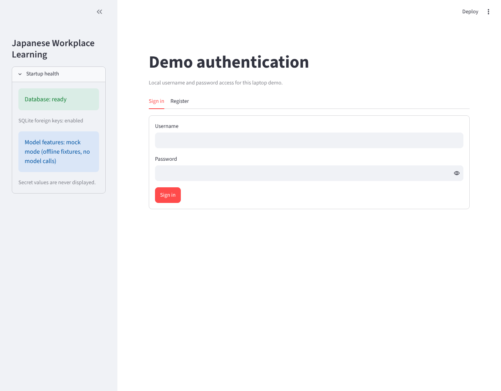

- Works: two tabs, short forms.
- Trips: the page is titled "Demo authentication … for this laptop demo" and never says what the app is. The sidebar "Startup health" panel (database, SQLite, model mode) and Streamlit's "Deploy" menu show to every learner.

### Profile setup

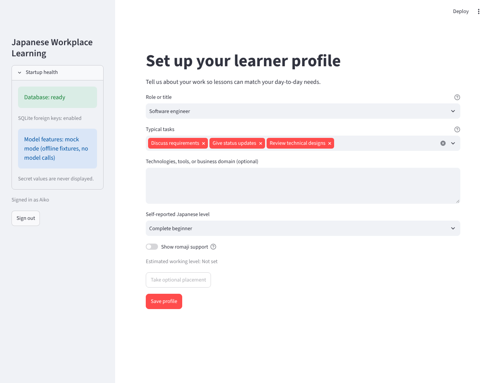

- Works: role search accepts your own title, tasks are editable chips, romaji toggle.
- Trips: "Software engineer" and three tasks are preselected, so Save works without choosing anything. Typing my own role ("Hardware engineer") emptied the task list and offered no suggestions. Level starts at "Complete beginner". "Take optional placement" is disabled with only a hover note. Red chips read like errors.

### Home

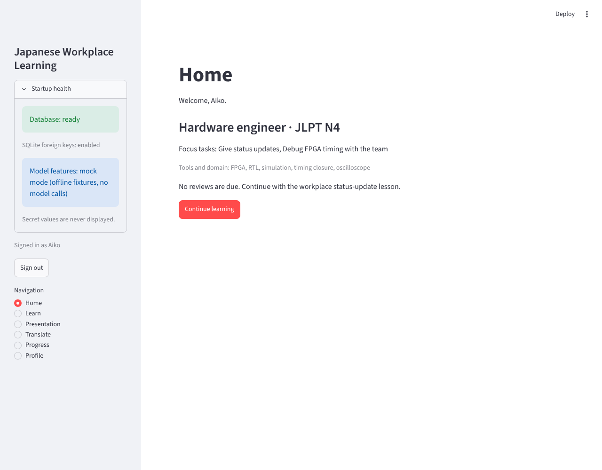

- Works: the This week card after the first lesson; the due-review prompt is clear and skippable.
- Trips: a brand-new learner is told "No reviews are due. Continue with the workplace status-update lesson", but nothing explains how the app works or what to do first. Home said "6 items due" and the review held 5. After the review it showed "Earliest review: 2026-10-25 01:32", a time already past, in UTC.

### Learn: lesson

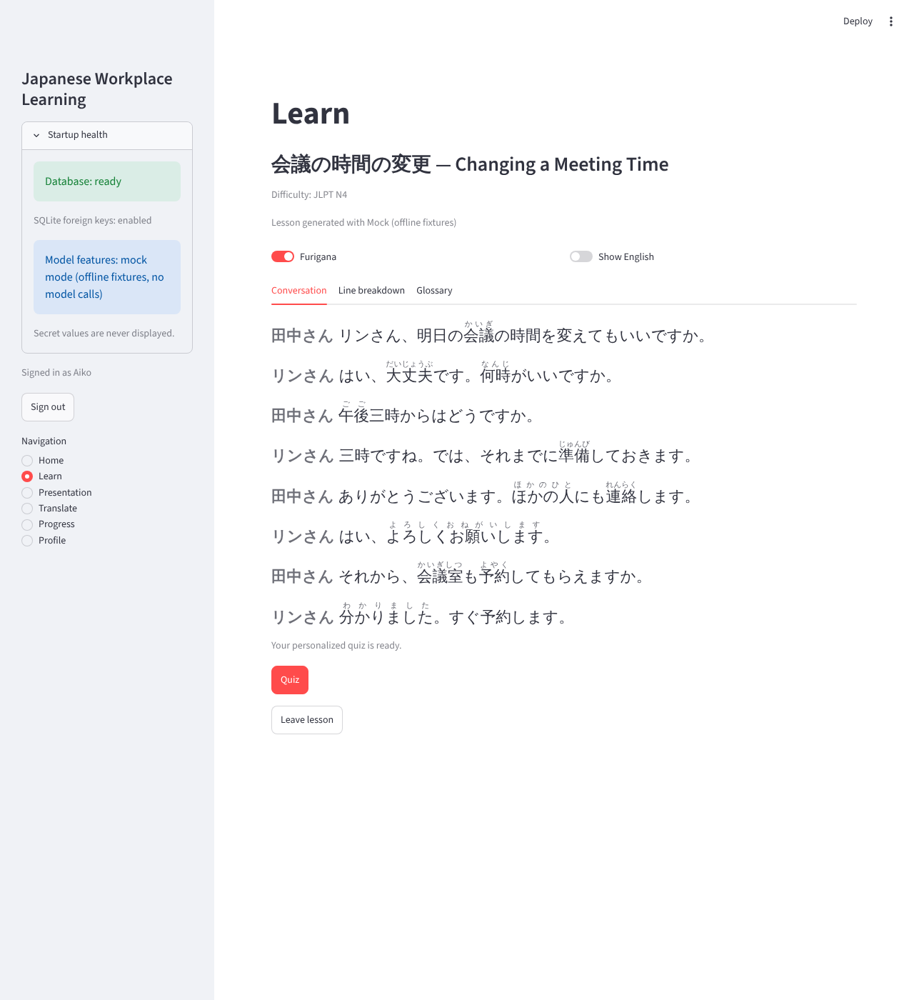

- Works: the privacy warning and checkbox block Generate until ticked; furigana and English toggles; Conversation, Line breakdown and Glossary tabs.
- Trips: the warning says "no project details" while the box asks for a work situation, with no example of a safe one. The sample lesson is labelled "Start fixture lesson … records exposure only. It does not raise mastery". A surprise lesson needs an empty box plus Generate, which nothing says. Speaker names run into the line ("田中さん リンさん、…"). Furigana sits over kana too (ほかの人, よろしくお願いします, 分かりました). Words such as 会議 are labelled "Kanji", and the ⭐ marking quiz targets is never explained.

### Learn: quiz

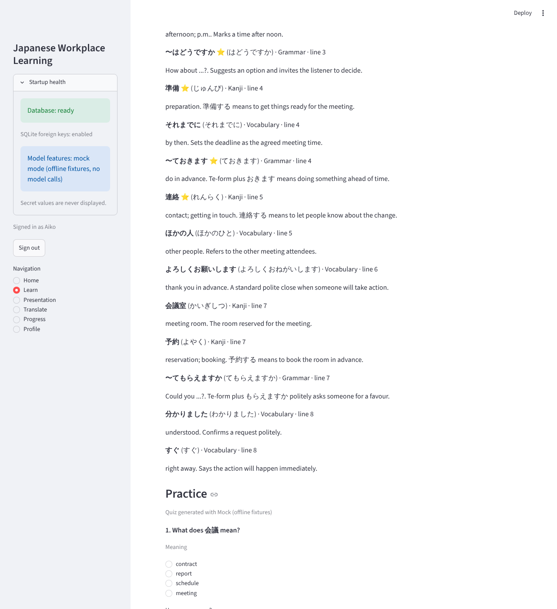

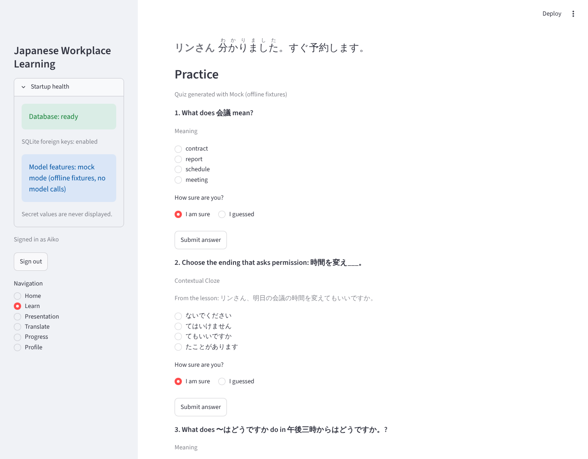

- Works: instant feedback with an explanation, a corrective retry for misses, a confidence question.
- Trips: the quiz opens under the whole lesson and glossary, so the answers are on screen; fill-in questions quote the answer sentence. Six questions take 18 clicks (answer, confidence, submit). Confidence defaults to "I am sure", so guesses count as sure unless changed. Wording such as "Contextual Cloze", "This counts as Hard, not a first-try success" and "Recovery is stored separately" is scheduler language. The finish message ("Your compact progress and review schedule were saved") says nothing about what was learned or when reviews come.

### Due review

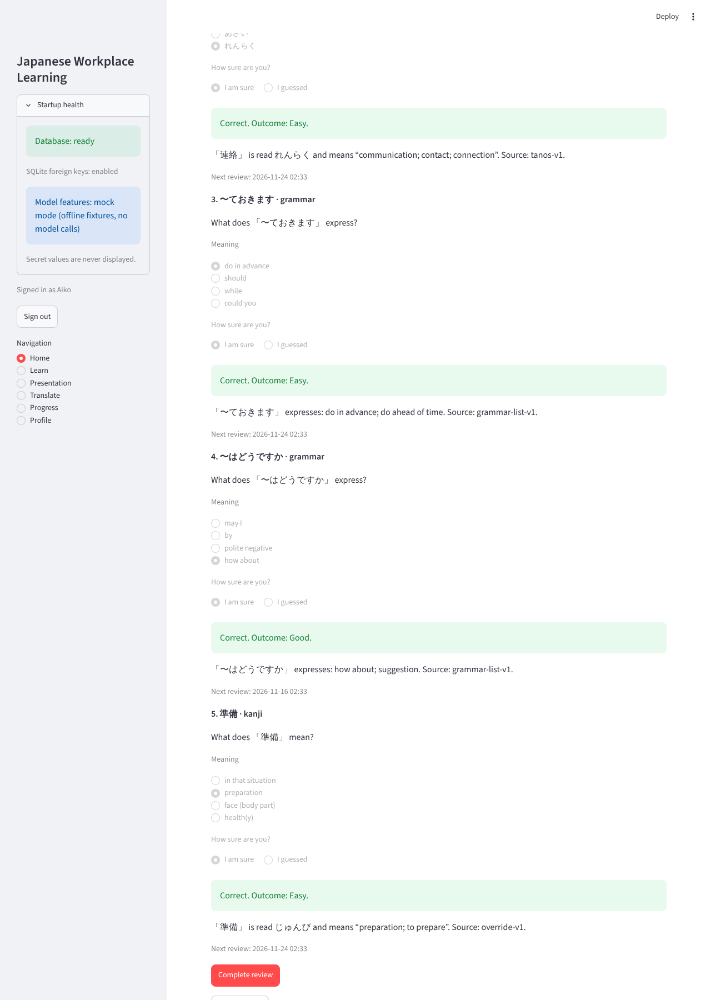

- Works: code-built questions, five at a time, skippable.
- Trips: "Outcome: Easy" and "Source: tanos-v1 / override-v1 / grammar-list-v1" are shown to learners. Next-review times are UTC timestamps. Some wrong options are too easy to rule out (あさい as a reading of 連絡; "by" as a meaning of 〜はどうですか).

### Progress

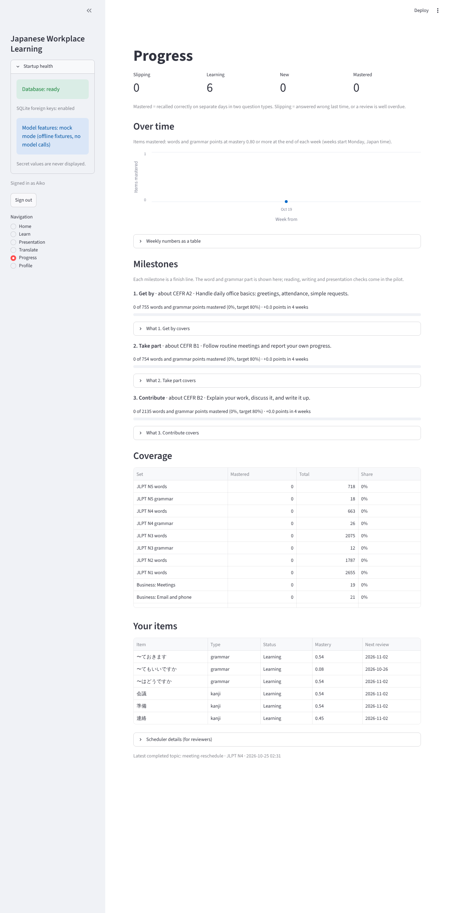

- Works: status counts, the over-time chart, milestones with their tasks, real item names.
- Trips: everything is zero on day one, including "+0.0 points in 4 weeks" and 14 coverage rows at 0%. The chart is a single point. "Latest completed topic: meeting-reschedule · 2026-10-25 02:31" shows an ID and a UTC time. The caption about separate days is wrong today (top finding 2).

### Presentation, Translate, Profile

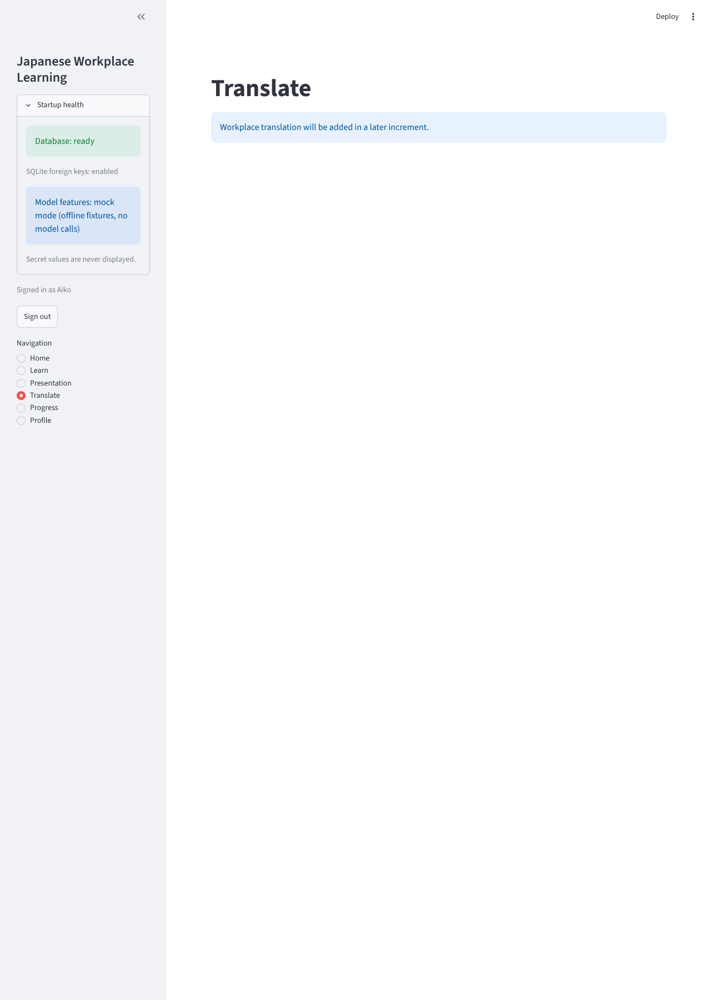

- Presentation puts two full forms on one page (localize a deck, practise a Japanese deck), each with its own warning and checkbox.
- Translate is a placeholder ("will be added in a later increment") in the main navigation.
- Profile reuses the setup form; fine.

### Reviewer mode

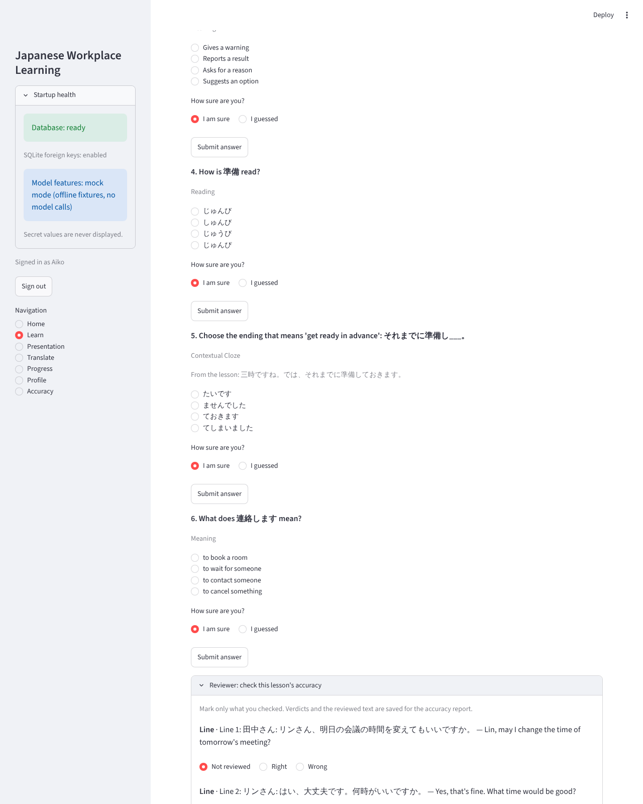

- Works: one panel per lesson, a verdict per line, item and question, reasons and notes, then the Accuracy report.
- Trips: 26 rows of radios for one lesson with no "mark all right" shortcut. The panel exists only for AI lessons after the quiz, so the code-built review questions and the sample lesson cannot be checked, though the team review is meant to cover them.

### Phone width

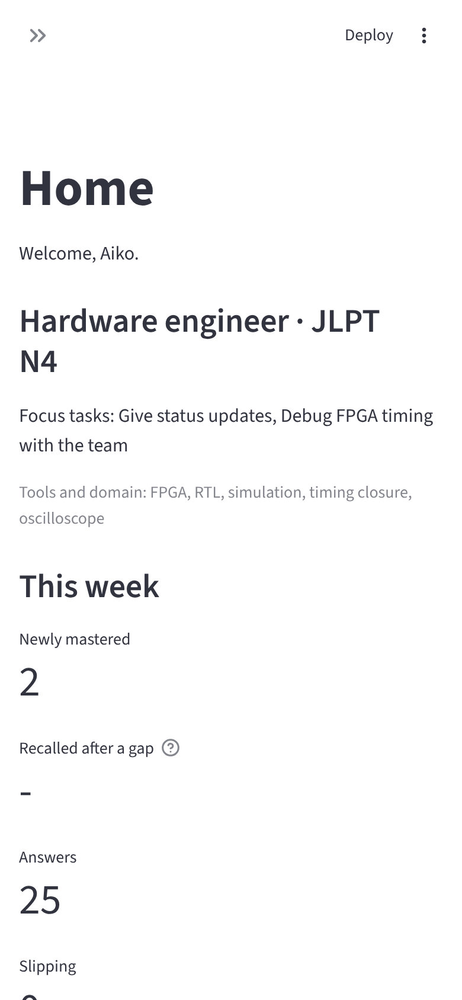

- Navigation hides behind "»", and the profile summary plus four stacked numbers push the main action off the first screen. Desktop is the main target, so this is low priority.

## Upcoming flow (Phases 3–5)

The plan turns the app into one daily loop run from Home. It holds together, but six spots could stall learners if built as written.

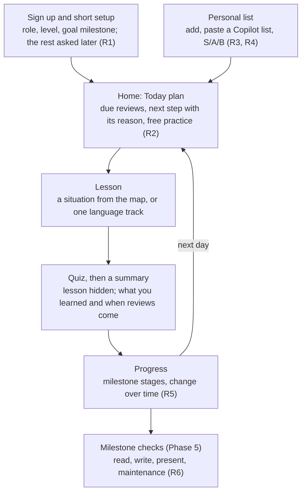

| Risk | What could go wrong | What I'd do instead |
| --- | --- | --- |
| R1 | Setup grows to role, tasks, domains, conversation partners, level, milestone and Copilot, a long form before any Japanese | Ask only role, level and goal at sign-up; ask domains when the first word set appears and partners at the first situation lesson |
| R2 | Six tracks shown as a menu turn "what next?" back into the learner's job | One "Start today" button that runs reviews, then the chosen step with its reason; at most one "swap" |
| R3 | Grading hundreds of words S, A or B is tedious, so most stay at the default | Grade only when adding; a single "important for my job" star marks S, and B comes from "not useful" |
| R4 | The Copilot route spans two apps and a privacy judgement | A "Copy Copilot prompt" button, then a paste box with the per-line preview and the public-only note |
| R5 | Milestone bars move about 1% a week, which feels like no progress | Split each milestone into stages of about 50 items with their own bar, plus the "at your pace" date |
| R6 | Presentation sign-off needs a second person and a role the app does not have | Learner self-check by default; senior sign-off as an optional link that the senior opens without an account |

Two current problems carry into the plan and should be fixed before Phase 3 builds on them: the quiz must hide the lesson (step 4), and mastery must need separate days, or the Today plan and milestone bars will be built on inflated numbers.

## Fix list

Fix rows 1 and 2 before the team accuracy review: they distort exactly what the team will judge. Effort is my estimate: S = under half a day, M = one to two days.

| # | Fix | Severity | Effort | When |
| --- | --- | --- | --- | --- |
| 1 | Hide the lesson while the quiz is open; drop or blank the answer in the "From the lesson" sentence | High | S | Before team review |
| 2 | Mastery needs successes on separate days, not separate sessions (policy t05-v2, replayed from stored answers); correct the Progress caption | High | S–M | Before team review |
| 3 | Learner-facing wording: remove "Demo authentication", "fixture", "exposure", "Outcome: Easy/Hard", "Source: …", "Contextual Cloze", "compact progress"; hide Startup health and the Deploy menu; keep sources visible in reviewer mode only | Medium | S | Before team review |
| 4 | Reviewer mode: a "mark all right" shortcut, and review panels for due-review questions and the sample lesson | Medium | S–M | Before team review |
| 5 | Conversation: speaker name as a label ("田中さん:"), furigana over kanji only | Medium | M | Before team review |
| 6 | Lesson finish summary: what you practised, what was hard, when the next review is | Medium | S | Before team review |
| 7 | Confidence: two submit buttons ("Sure" and "Guessed") instead of a preselected "I am sure" plus Submit | Medium | S | Before team review |
| 8 | First run: one line on what the app is; no preselected role or tasks; keep task suggestions for a custom role; hide the disabled placement button; a first-visit Home with one "Start your first lesson" | Medium | S | Before team review |
| 9 | Learn: a "Surprise me" button, and examples of safe situations under the privacy warning | Medium | S | Before team review |
| 10 | Times in Japan time and relative ("in 3 days"); "5 of 6 due" when the review is capped | Low | S | Before team review |
| 11 | Hide Translate from navigation until it exists | Low | S | Before team review |
| 12 | Review distractors: readings only by small changes to the real reading, meanings from the same kind of word | Low | S | After team review flags |
| 13 | New learners see their chosen milestone in stages of about 50 items; zero coverage rows behind "Show all" | Medium | M | Phase 3 |
| 14 | Upcoming risks R1–R6: the changes in the table above | Medium | — | Phases 3 and 5 |
| 15 | Presentation: the two forms as two tabs | Low | S | Phase 3 |
| 16 | Phone layout: main action first, profile summary collapsed | Low | M | Phase 4 |
